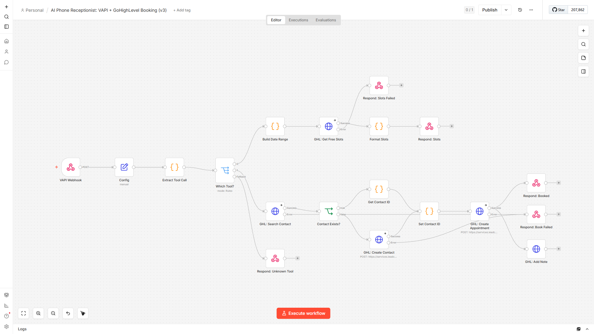
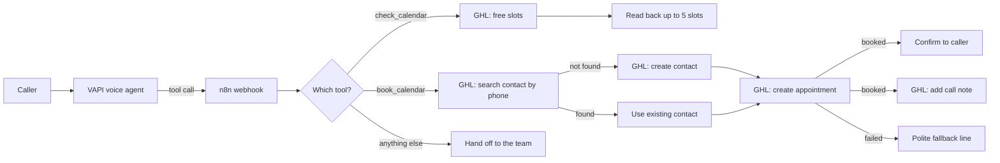

# AI Phone Receptionist: VAPI + GoHighLevel Booking

An AI voice receptionist that answers the phone, checks real availability in a GoHighLevel calendar, books the appointment during the call, and logs everything in the CRM. Built with n8n.

## The problem

Service businesses lose bookings every day to missed calls. When nobody picks up, the caller rings the next company on the list. Even when someone does answer, the booking still has to be typed into the CRM by hand, and the call details are rarely written down.

## What this does

A VAPI voice agent handles the conversation. Whenever it needs to check the calendar or book a slot, it calls this n8n workflow as a tool, and the workflow does the work in GoHighLevel while the caller is still on the line:

1. **Checks availability.** Pulls free slots from the GoHighLevel calendar and reads back up to five options in the business's time zone.
2. **Finds or creates the contact.** Searches GoHighLevel by the caller's phone number, so returning callers are matched to their existing record instead of being duplicated.
3. **Books the appointment** with a proper start and end time and a title built from the caller's name and reason.
4. **Logs a call note** on the contact with the caller, phone, time and reason.
5. **Always answers.** If GoHighLevel is down or rejects a request, the caller hears a polite fallback line instead of silence, and an optional alert workflow posts the failure to Slack.

## How it works

The webhook holds the connection open until one of the "Respond" nodes replies, which is what VAPI's tool calls expect. The confirmation goes back to the caller first, and the call note is written right after, so the caller never waits on the note.

## Workflow at a glance

| Step | Node | What it does |
|---|---|---|
| 1 | VAPI Webhook | Receives every tool call from VAPI (POST) |
| 2 | Config | Loads the GoHighLevel settings from environment variables |
| 3 | Extract Tool Call | Reads the tool name, caller phone, requested time, name and reason; turns the time into a valid ISO date |
| 4 | Which Tool? | Routes to check, book, or a fallback |
| 5 | Build Date Range, GHL: Get Free Slots, Format Slots | Gets four days of availability and formats five readable options |
| 6 | GHL: Search Contact, Contact Exists? | Matches returning callers by phone |
| 7 | GHL: Create Contact, Set Contact ID | Creates new callers with source "VAPI Inbound Call" |
| 8 | GHL: Create Appointment | Books the slot (60 minutes by default) |
| 9 | GHL: Add Note | Logs the call on the contact |
| 10 | Respond nodes | Booked, Slots, Slots Failed, Book Failed, Unknown Tool |

## Setup

**You need:** n8n (self-hosted or cloud), a GoHighLevel sub-account with a calendar, and a VAPI account.

1. Import `workflow/ai-phone-receptionist-ghl.json` into n8n.
2. Copy `.env.example` to your n8n environment and fill in the values (see the table below). The Config node reads them with `$env`, so self-hosted n8n needs `N8N_BLOCK_ENV_ACCESS_IN_NODE=false`.
3. Activate the workflow and copy its production webhook URL (`/webhook/vapi-ghl-setter`).
4. In VAPI, add two tools that point at that URL. Step by step, with tool definitions and a sample prompt: [docs/vapi-setup.md](docs/vapi-setup.md).
5. Optional: import `workflow/error-alert-slack.json`, set `SLACK_WEBHOOK_URL`, and choose it as the **Error Workflow** in the receptionist's workflow settings.

| Variable | Where to find it |
|---|---|
| `GHL_API_KEY` | GoHighLevel → Settings → Private Integrations (token starts with `pit-`) |
| `GHL_LOCATION_ID` | GoHighLevel → Settings → Business Profile |
| `GHL_CALENDAR_ID` | Open the calendar in GoHighLevel and copy the ID from the URL |
| `GHL_TIMEZONE` | The business time zone, for example `America/New_York` |
| `TEST_PHONE` | Optional: a phone number to use when testing without a real call |
| `SLACK_WEBHOOK_URL` | Optional: a Slack incoming webhook for failure alerts |

## Testing

The workflow was tested end to end on n8n against a **mock GoHighLevel API**, so no real account was touched. All six scenarios pass:

| Scenario | Result |
|---|---|
| Unknown tool name | Hands the caller to the team |
| Check calendar, GoHighLevel rejects the request | Polite "trouble checking the calendar" reply |
| Book, GoHighLevel rejects the request | Polite "something went wrong with the booking" reply |
| Check calendar | Reads back the right slots in the business time zone |
| Book, new caller | One contact created, appointment booked, note logged |
| Book, returning caller | Existing contact reused, no duplicate created |

Full requests and replies: [docs/test-report.md](docs/test-report.md). Run the same tests yourself with [tests/e2e_mock_test.py](tests/e2e_mock_test.py).

## What changed in v3

Testing the earlier version against the mock API surfaced five bugs that would have hit real callers, including callers being duplicated in the CRM and the wrong times being read out. All five are fixed in v3. Details in [CHANGELOG.md](CHANGELOG.md).

## Limitations and next steps

- Reschedule and cancel are not built yet; they would be two more VAPI tools on the same webhook.
- The GoHighLevel token is passed in a header from an environment variable. For production, move it into an n8n credential so it never appears in execution data.
- The webhook trusts any caller who knows the URL. In production, add VAPI's server secret header and check it in the first node.
- A text message confirmation after booking would be a natural next step (a GoHighLevel workflow triggered by the new appointment).

## About

Built by **Romiel Inolino**, AI and CRM Automation Specialist working with GoHighLevel, Monday.com, ClickUp, n8n, Make and Zapier.
Portfolio and case studies: [romielwillautomate.dev](https://romielwillautomate.dev)

This repository is a portfolio implementation. Credentials, API keys and customer data are not included, and all test data is made up.
